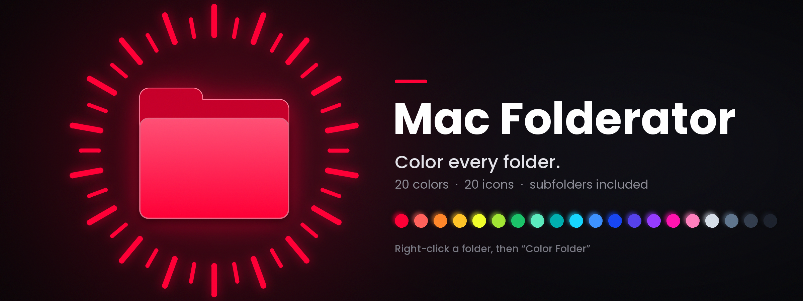
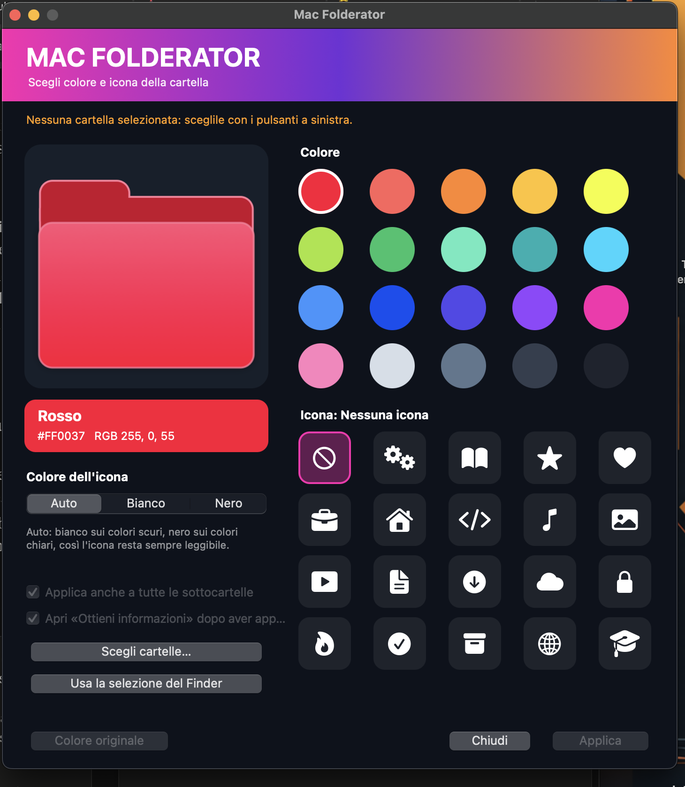
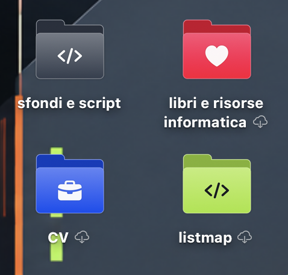

<p align="center"></p>

<p align="center"><a href="README.md">🇬🇧 English</a></p>

<p align="center">
  <a href="../../releases/latest"><b>⬇️ Scarica l'ultima versione (.dmg)</b></a>
  &nbsp;&nbsp;·&nbsp;&nbsp;
  <a href="https://ko-fi.com/your-ko-fi-username"><b>☕ Sostieni il progetto</b></a>
</p>

# Mac Folderator

**Dai alle cartelle del tuo Mac il colore (e l'icona) che vuoi.**
Tasto destro su una cartella → **Colora cartella** → scegli tra **20 colori** e **20 icone**, guardi l'anteprima e premi *Applica*. La cartella — e tutte le sue sottocartelle — prendono il nuovo aspetto.

Mac Folderator cambia **solo le cartelle che scegli**: nessun processo in background, nessuna colorazione automatica. Non tocca sfondo, tema, Dock, impostazioni di sistema né le icone delle altre app, e si disinstalla del tutto.

## Anteprime

**La finestra** — scegli cartelle, colore e icona, con anteprima in tempo reale:

<p align="center"></p>

**Il risultato** — cartelle colorate con icone, direttamente nel Finder:

<p align="center"></p>

## Cosa fa

- **20 colori** in una palette coordinata, con anteprima del colore e della cartella in tempo reale.
- **Icona sul fronte della cartella**: nessuna, oppure 19 simboli (ingranaggi, libro aperto, stella, cuore, valigetta…). L'icona è **bianca sui colori scuri e nera sui chiari**, oppure scegli tu.
- **La cartella scelta e tutte le sue sottocartelle** vengono colorate in un colpo solo (togli la spunta *Applica anche a tutte le sottocartelle* per colorare solo la cartella).
- **Dimensione originale delle cartelle di macOS**: le cartelle riempiono l'icona come quelle di sistema.
- Più cartelle insieme; la finestra si apre vuota e le cartelle le scegli lì dentro (**Scegli cartelle…** oppure **Usa la selezione del Finder**). Le azioni restano disabilitate finché non c'è una cartella.
- **Colore originale** con un clic (anche per le sottocartelle).
- **L'app resta aperta** finché non chiudi la finestra, così puoi continuare a colorare.
- Funziona anche con le cartelle sotto **iCloud**.
- Interfaccia in italiano e inglese. Nessun accesso alla rete, nessuna raccolta di dati.

I 20 colori e le 20 icone sono elencati nel [README inglese](README.md#the-20-colors).

## Installazione

Serve macOS 12 o successivo (Apple silicon e Intel). Non servono password da amministratore.

**Opzione A — immagine disco**

1. Scarica il **.dmg** dall'[ultima release](../../releases/latest) (sotto *Assets*; oppure compilalo, vedi sotto) e aprilo.
2. Fai **doppio clic su Mac Folderator**: si installa da solo (si copia in **Applicazioni**, si apre da lì ed espelle il disco). In alternativa trascinalo tu in **Applicazioni**, espelli il disco e aprilo da lì.
3. Se macOS non lo apre perché non è notarizzato: tasto destro → **Apri** → **Apri**.

**Opzione B — compilalo tu**

Servono gli Strumenti da riga di comando di Apple (`xcode-select --install`), non Xcode intero.

```bash
git clone https://github.com/<tuo-utente>/mac-folderator.git
cd mac-folderator
./build.sh          # → dist/Mac Folderator.app  e  dist/Mac Folderator.dmg
```

Poi apri `dist/Mac Folderator.dmg` e segui l'Opzione A. Al primo avvio l'app aggiunge l'azione rapida **Colora cartella** al menu del tasto destro del Finder.

## Uso

Tasto destro su una o più cartelle → **Azioni rapide → Colora cartella** → scegli colore e icona → **Applica**. Con *Colore originale* la cartella (e le sottocartelle) tornano normali. La finestra resta aperta: puoi cambiare colore o premere **Scegli altre cartelle…**. Aprendo l'app da Applicazioni la finestra si apre subito e le cartelle le scegli lì dentro.

Se non vedi "Colora cartella" nel menu: Impostazioni di Sistema → Tastiera → Scorciatoie da tastiera → Servizi → File e cartelle (o Azioni rapide) e attivala.

Dentro un albero di cartelle vengono saltate: cartelle nascoste, pacchetti (`.app`, `.xcodeproj`…), cartelle di dipendenze/build (`node_modules`, `build`, `target`…) e collegamenti simbolici. La cartella che scegli viene sempre colorata.

**Cartelle sotto iCloud:** per ogni cartella sotto iCloud che colora, l'app apre e richiude la finestra «Ottieni informazioni» del Finder (circa un secondo a cartella, fino a 40 per volta), così macOS applica la nuova icona. Per una sola cartella fuori da iCloud, dopo *Applica* la finestra Ottieni informazioni resta aperta (togli la spunta per non averla).

## Disinstallazione

1. **Dall'app:** apri Mac Folderator → **Mac Folderator → Disinstalla…**. Si apre una finestra del Terminale che esegue lo script di rimozione (può chiedere la password del Mac): è lo stesso `scripts/uninstall.sh`, incluso nell'app.
2. **Dal disco:** riapri **Mac Folderator.dmg** e fai doppio clic su **Mac Folderator**: essendo già installato, chiede se *Aggiornare* o *Disinstallare…*; con *Disinstallare…* parte lo stesso script di rimozione nel Terminale (anche il disco viene espulso).
3. **Da Terminale:**
   ```bash
   "/Applications/Mac Folderator.app/Contents/MacOS/MacFolderator" --uninstall
   ```
   (con `--keep-icons` lasci le cartelle colorate).
4. **Con lo script di rimozione**, se l'app non si apre più o qualcosa si è bloccato:
   ```bash
   bash scripts/uninstall.sh
   ```
   Ferma l'app, rimuove azione rapida, impostazioni, app (anche dal Cestino) ed eventuali dischi montati, e ripristina l'icona originale delle cartelle colorate (`--keep-colors` le lascia colorate). Se macOS rifiuta di eliminare l'app, abilita il Terminale in **Impostazioni di Sistema → Privacy e sicurezza → Gestione app** e rilancia.
5. Oppure **trascina l'app nel Cestino**: l'azione rapida si rimuove da sola al primo utilizzo.

Vengono rimossi azione rapida, impostazioni e tutte le copie installate dell'app (ovunque siano). L'app viene eliminata; se macOS non lo permette viene spostata nel Cestino (il messaggio finale te lo dice: svuota il Cestino) e, se nemmeno questo riesce, te lo dice e mostra l'app nel Finder. Ogni passaggio è registrato in `/tmp/macfolderator-uninstall.log`. Non viene toccato nient'altro sul Mac.

## Da Terminale

`MacFolderator <cartella> …`, `--diagnose <cartella>`, `--reset <cartelle…>` (con `--no-subfolders` lasci stare le sottocartelle), `--uninstall [--keep-icons]`, `--help` — il binario è in `/Applications/Mac Folderator.app/Contents/MacOS/MacFolderator`.

## Se qualcosa non va

- **Una cartella sembra invariata:** `--diagnose ~/percorso/cartella`, poi `killall Finder`.
- **Permessi:** Impostazioni di Sistema → Privacy e sicurezza → Accesso completo al disco → abilita Mac Folderator. La prima volta macOS può chiedere di far controllare il Finder all'app: consenti.
- **L'app si chiude all'improvviso:** una traccia resta in `~/.macfolderator/crash.log` e macOS salva un rapporto in `~/Library/Logs/DiagnosticReports/` (cerca `MacFolderator`). Apri una [issue](../../issues) e allegalo.

## Da sapere

- Colori e icone sono **icone personalizzate** di macOS: restano alla cartella se la sposti o rinomini, ma **non sopravvivono se la copi su un altro Mac o la carichi online**.
- Il colore non cambia nella *barra laterale* del Finder.
- L'app è firmata ad-hoc, non notarizzata: se condividi il `.dmg`, al primo avvio su un altro Mac serve tasto destro → Apri.
- Testato su macOS.

## Sostieni il progetto

Mac Folderator è gratuito e open source. Se ti fa risparmiare tempo e vuoi dire grazie, puoi offrirmi un caffè:

<p align="center"><a href="https://ko-fi.com/your-ko-fi-username"></a></p>

Anche una stella al repository e una condivisione aiutano. ⭐

## Licenza

[MIT](LICENSE)
