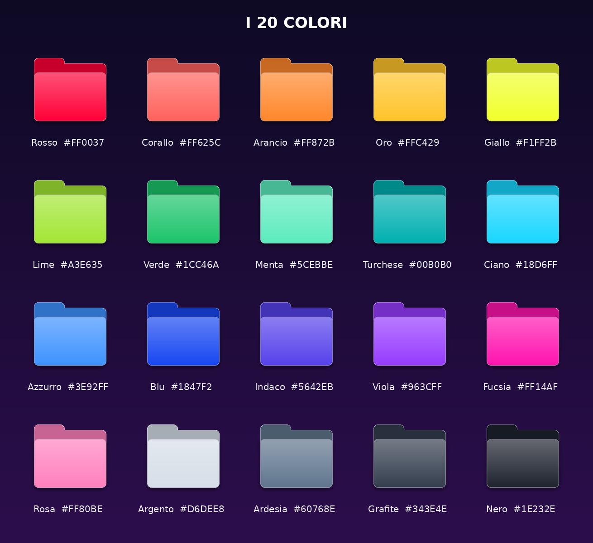

<p align="center"></p>

<p align="center">
  
  
  
  &nbsp;·&nbsp; <a href="README.it.md">🇮🇹 Italiano</a>
</p>

<p align="center">
  <a href="../../releases/latest"><b>⬇️ Download the latest version (.dmg)</b></a>
  &nbsp;&nbsp;·&nbsp;&nbsp;
  <a href="https://ko-fi.com/your-ko-fi-username"><b>☕ Support the project</b></a>
</p>

# Mac Folderator

**Give your Mac's folders the color (and the icon) you want.**
Right-click a folder → **Color Folder** → pick one of **20 colors** and one of **20 icons**, check the live preview, press *Apply*. The folder — and all its subfolders — get the new look.

Mac Folderator changes **the folders you choose, and nothing else**: no background process, no automatic coloring. It never touches your wallpaper, theme, Dock, system settings or the icons of other apps, and it uninstalls cleanly.

## Screenshots

**The window** — choose folders, color and icon, with a live preview:

<p align="center"></p>

**The result** — colored folders with icons, right in the Finder:

<p align="center"></p>

## Features

- **20 colors** in a coordinated palette (neon and calm tones), with name and color code.
- **A dedicated window** with a live preview of the color *and* of the folder while you choose.
- **An icon on the folder front**: none, or one of 19 symbols (gears, open book, star, heart, briefcase…). The icon is **white on dark colors and black on light colors** so it is always readable — or force white/black yourself.
- **The chosen folder and all its subfolders** are colored in one go (untick *Also apply to all subfolders* to color only the folder itself).
- **The original macOS folder size**: the folders fill the icon exactly like the system ones.
- Select **several folders** at once; the window opens empty and you choose the folders inside it (**Choose folders…** or **Use the Finder selection**). Actions stay disabled until a folder is selected.
- **Original color** with one click (also for the subfolders).
- **The app stays open** until you close its window, so you can keep coloring.
- Works with folders under **iCloud** too (see below).
- English and Italian interface (follows your system language). No network access, no analytics.

## The 20 colors

<p align="center"></p>

Red `#FF0037` · Coral `#FF625C` · Orange `#FF872B` · Gold `#FFC429` · Yellow `#F1FF2B` · Lime `#A3E635` · Green `#1CC46A` · Mint `#5CEBBE` · Teal `#00B0B0` · Cyan `#18D6FF` · Sky Blue `#3E92FF` · Blue `#1847F2` · Indigo `#5642EB` · Purple `#963CFF` · Fuchsia `#FF14AF` · Pink `#FF80BE` · Silver `#D6DEE8` · Slate `#60768E` · Graphite `#343E4E` · Black `#1E232E`

## The 20 icons (and what they are good for)

| Icon | Idea |
|---|---|
| No icon | Color only |
| Gears | Settings, configurations, technical projects |
| Open book | Study, manuals, ebooks, notes |
| Star | Favorites, things you care about |
| Heart | Personal, family |
| Briefcase | Work, clients, paperwork |
| House | Home, bills, family documents |
| Code `</>` | Development, software projects |
| Music note | Music, audio, podcasts |
| Photo | Images, graphics, shots |
| Video | Movies, recordings, edits |
| Document | Texts, contracts, letters |
| Download | Downloaded files to sort out |
| Cloud | Synced folders, online backups |
| Padlock | Private, confidential |
| Flame | Urgent, important |
| Checkmark | Done, filed away |
| Archive | Old projects, history |
| Globe | Web, sites, links |
| Graduation cap | University, courses |

Icons are macOS system symbols (SF Symbols), so they match the look of the rest of the system.

---

## Install

Requires macOS 12 or later (Apple silicon and Intel). No administrator password is needed.

### Option A — the disk image

1. Download the **.dmg** from the [latest release](../../releases/latest) (under *Assets*; or build it yourself, see below) and open it.
2. **Double-click Mac Folderator** in the window that appears. It installs itself: it copies itself into **Applications**, opens from there and ejects the disk. (Or drag it onto the **Applications** folder yourself, eject the disk and open it from Applications.)
3. If macOS says it cannot be opened (the app is ad-hoc signed, not notarized): right-click it → **Open** → **Open**.

### Option B — build it yourself

You need the Xcode Command Line Tools (`xcode-select --install`), not the full Xcode.

```bash
git clone https://github.com/<your-user>/mac-folderator.git
cd mac-folderator
./build.sh          # → dist/Mac Folderator.app  and  dist/Mac Folderator.dmg
```

Then open `dist/Mac Folderator.dmg` and follow Option A. (`./build.sh --app` builds only the `.app`.)

On first launch the app adds the **Color Folder** Quick Action to the Finder's right-click menu.

## Use

1. In the Finder, **right-click** a folder (or several selected folders).
2. **Quick Actions → Color Folder**.
3. Pick a **color** and an **icon**; the preview on the left updates instantly. Under *Icon color* choose *Auto*, *White* or *Black*.
4. Keep **Also apply to all subfolders** ticked to color the whole tree, or untick it.
5. **Apply**. *Original color* removes color and icon (from the subfolders too, if ticked).

The window stays open: pick another color, or press **Choose other folders…** to continue with other folders. Close the window when you are done.

> Don't see "Color Folder" in the menu? Open **System Settings → Keyboard → Keyboard Shortcuts → Services → Files and Folders** (or *Quick Actions*) and enable it. You can always open **Mac Folderator** from Applications: the window opens right away and you choose the folders inside it. Until at least one folder is selected, *Apply*, *Original color* and the folder options stay disabled; you can still try colors and icons in the preview.

**What is skipped inside a tree:** hidden folders, packages (`.app`, `.xcodeproj`…), dependency/build folders (`node_modules`, `build`, `target`…) and symbolic links. The folder you choose is always colored.

### Folders under iCloud

Folders under iCloud (iCloud Drive, and Desktop/Documents when "Desktop & Documents Folders" is on) are colored like any other. Mac Folderator does not rely on iCloud syncing to make the color show: **for every folder under iCloud it colors, it opens the Finder's "Get Info" window and closes it again** (about a second per folder, up to 40 per run; the rest refresh on their own), which makes macOS apply the new icon.

For a single folder outside iCloud, **Get Info** is opened and left open after *Apply* (untick *Open «Get Info» after applying* to turn this off).

## Uninstall

Pick whichever you prefer:

1. **From the app:** open Mac Folderator and choose **Mac Folderator → Uninstall…**. A Terminal window opens and runs the removal script (it may ask for your Mac password) — that is the same `scripts/uninstall.sh`, bundled inside the app.
2. **From the disk image:** open **Mac Folderator.dmg** again and double-click **Mac Folderator**. Since it is already installed, it asks whether to *Update* or *Uninstall…*; choosing *Uninstall…* runs the same removal script in Terminal (the disk is ejected too).
3. **From Terminal:**
   ```bash
   "/Applications/Mac Folderator.app/Contents/MacOS/MacFolderator" --uninstall
   ```
   (add `--keep-icons` to leave the folders colored).
4. **With the removal script**, if the app no longer opens or something got stuck:
   ```bash
   bash scripts/uninstall.sh
   ```
   It stops the app, removes the Quick Action, the settings, the app (also from the Trash) and any mounted installer disk, and restores the original icon of every folder it colored (`--keep-colors` leaves them colored). If macOS refuses to delete the app, enable Terminal in **System Settings → Privacy & Security → App Management** and run it again.
5. Or simply **drag the app to the Trash**: the Quick Action then removes itself the next time you use it.

Uninstalling removes the Quick Action, the settings and every installed copy of the app (wherever it is), and (your choice) restores the original icon of every folder Mac Folderator colored. The app is deleted; if macOS does not allow that, it is moved to the Trash (the final message tells you, so empty the Trash), and if even that fails you are told and the app is shown in the Finder. Every step is logged in `/tmp/macfolderator-uninstall.log`. Nothing else on your Mac is touched.

## Command line

The app binary also works from Terminal (`/Applications/Mac Folderator.app/Contents/MacOS/MacFolderator`):

```
<folder> ...             open the window for these folders
--diagnose <folder>      explain the state of a folder
--reset <folders...>     restore the original icon of the folders and their subfolders
                         (add --no-subfolders to leave the subfolders alone)
--uninstall [--keep-icons]
--help
```

## Project layout

```
mac-folderator/
├── build.sh                 builds the app and the .dmg
├── Sources/
│   ├── main.swift           entry point, menu, install/uninstall flow, Finder helpers
│   ├── Palette.swift        20 colors, 20 icons, language helper
│   ├── Renderer.swift       draws the folder icon (preview = real icon)
│   ├── PickerWindow.swift   the "Color Folder" window
│   ├── Installer.swift      Finder Quick Action, uninstall, install from the disk image
│   ├── Rules.swift          what is skipped, how a folder tree is collected and applied
│   ├── Registry.swift       list of colored folders (~/.macfolderator), used to restore them
│   └── UIHelpers.swift      small UI helpers
├── Resources/AppIcon.png    app icon
├── scripts/uninstall.sh     full removal script
└── docs/                    images used by this README
```

`build.sh` compiles `Sources/*.swift` (a universal binary when possible), builds the icon from `Resources/AppIcon.png`, ad-hoc signs the app and creates a disk image containing just the app and an *Applications* shortcut.

## If something is not right

- **A folder looks unchanged:** run `"/Applications/Mac Folderator.app/Contents/MacOS/MacFolderator" --diagnose ~/path/to/folder`, then `killall Finder`.
- **Permissions:** if macOS refuses to change some folders (Documents, Desktop, external drives), open **System Settings → Privacy & Security → Full Disk Access** and enable **Mac Folderator**. The first time, macOS may also ask to let the app control the Finder: allow it.
- **The app quits unexpectedly:** a trace is saved in `~/.macfolderator/crash.log`, and macOS keeps a report in `~/Library/Logs/DiagnosticReports/` (look for `MacFolderator`). Please [open an issue](../../issues) and attach it.

## Good to know

- Folder colors and icons are **custom icons** in macOS: they stay with the folder when you move or rename it, but **they do not survive copying the folder to another Mac or uploading it online**.
- Colors are not applied to the Finder *sidebar*, where macOS uses its own icons.
- Mac Folderator never changes your wallpaper, theme or Dock.
- The app is ad-hoc signed, not notarized. If you share the `.dmg`, the first launch on another Mac needs right-click → Open.
- Tested on macOS.

## Support

Mac Folderator is free and open source. If you like it, and you want to say thanks, you can buy me a coffee:

[](https://ko-fi.com/D6B7293SIZ)

Starring the repository and sharing it helps just as much. ⭐

## License

[MIT](LICENSE)
